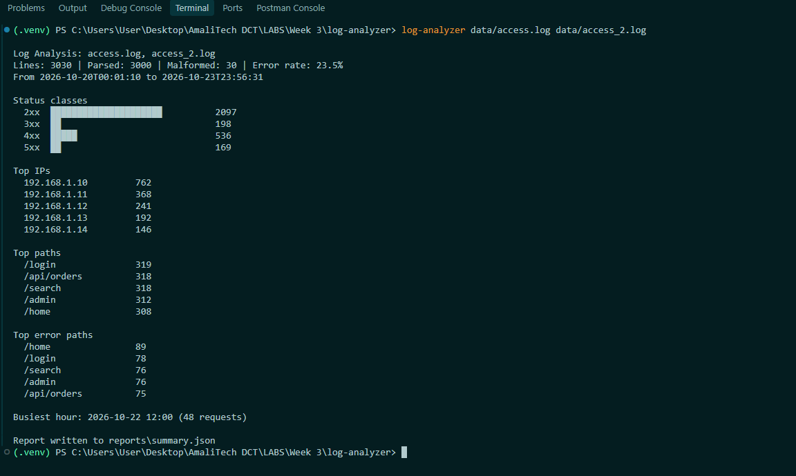
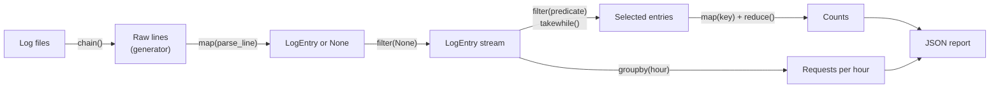

# Log File Analyzer

A command-line tool and Python library that parses web server access logs with regular expressions and turns them into analytics: status code breakdowns, error rates, top IPs and paths, and traffic per hour.

Built for the **Python Advanced** module to practise regular expressions, functional programming (`map`, `filter`, `reduce`), generators and iterators, decorators, and `itertools` / `functools`.



## Features

- Parses each log line with a single documented regex using named groups, and validates IPs, emails and URLs with regex patterns.
- Skips malformed lines instead of crashing, and reports how many there were.
- Processes data through a functional pipeline: `map` to transform, `filter` to select, `reduce` to aggregate, with `functools.partial` for reusable filters.
- Reads files with generators, so memory use stays constant whatever the file size.
- Combines several log files into one stream with `itertools.chain`.
- Groups traffic by hour with `itertools.groupby`, filters time ranges with `takewhile`, and pages through results with `islice`.
- Batches entries with a custom iterator class.
- Times and traces functions with chainable `@timer` and `@log_call` decorators, and caches IP validation with `functools.lru_cache`.
- Writes a JSON report whose structure is defined with `TypedDict`.
- Fully type-hinted (passes `mypy --strict`), with no runtime dependencies beyond the standard library.

## Requirements

- Python 3.11 or newer
- `pytest` and `mypy` for development (installed via `requirements.txt`)

## Setup

```bash
git clone https://github.com/B-Pine/log-analyzer.git
cd log-analyzer

python -m venv .venv
source .venv/bin/activate          # Windows: .venv\Scripts\activate

pip install -r requirements.txt
```

`requirements.txt` also installs the project in editable mode (`-e .`), which registers the `log-analyzer` command.

## Usage

### Command line

```bash
log-analyzer data/access.log
log-analyzer data/access.log data/access_2.log -o reports/summary.json --top 10 -v
```

| Option | Default | Description |
|---|---|---|
| `logs` | (required) | One or more log files, in chronological order |
| `-o`, `--output` | `reports/summary.json` | Where to write the JSON report |
| `--top` | `5` | Entries per "top" list (must be 1 or more) |
| `-v`, `--verbose` | off | Show how long each analysis step takes |

The tool can also be run as `python -m log_analyzer data/access.log`.

**Exit codes:** `0` on success, `1` if a file couldn't be read or written (the error goes to stderr), `2` for invalid arguments.

### As a library

```python
from datetime import datetime
from operator import attrgetter

from log_analyzer.file_io import read_many
from log_analyzer.pipeline import between, count_by, is_error, parse_lines, select, top

entries = parse_lines(read_many(["data/access.log", "data/access_2.log"]))
error_paths = count_by(attrgetter("path"), select(entries, is_error))
print(top(error_paths, n=3))

morning = between(datetime(2026, 10, 20, 8), datetime(2026, 10, 20, 12),
                  parse_lines(read_many(["data/access.log"])))
print(sum(1 for _ in morning), "requests between 08:00 and 12:00")
```

### Generating sample logs

```bash
python scripts/generate_sample_logs.py                                          # data/access.log
python scripts/generate_sample_logs.py --start 2026-10-22 --seed 7 -o data/access_2.log
```

Each file holds 1,500 valid lines over two days plus about 1% deliberately malformed lines. A few IPs make most requests, as in real traffic, and timestamps are in order, as servers write them.

## Log format

Each line is one request:

```
2026-10-20 08:15:32 192.168.1.10 GET /home 200
```

| Field | Example | Notes |
|---|---|---|
| timestamp | `2026-10-20 08:15:32` | `YYYY-MM-DD HH:MM:SS` |
| ip | `192.168.1.10` | Must be a valid IPv4 address |
| method | `GET` | Uppercase HTTP method |
| path | `/home` | Starts with `/`, may include a query string |
| status | `200` | Three-digit HTTP status code |

Lines that don't match, such as missing fields, impossible dates (`2026-13-45`) or invalid IPs (`999.168.1.10`), are counted as malformed and skipped.

## Regular expressions

All regex lives in the `patterns/` package, so every pattern is defined and documented in one place.

### The log line pattern

`patterns/log_formats.py` defines one compiled pattern, written with `re.VERBOSE` so each field sits on its own commented line:

```python
LOG_LINE = re.compile(r"""
    ^(?P<timestamp>\d{4}-\d{2}-\d{2}\s\d{2}:\d{2}:\d{2})   # 2026-10-20 08:15:32
    \s(?P<ip>\S+)                                         # 192.168.1.10
    \s(?P<method>[A-Z]+)                                  # GET
    \s(?P<path>/\S*)                                      # /home
    \s(?P<status>\d{3})$                                  # 200
""", re.VERBOSE)
```

| Piece | Meaning |
|---|---|
| `(?P<name>...)` | A named group, read with `match["name"]` instead of counting positions |
| `\d{4}`, `\d{2}`, `\d{3}` | Exactly 4, 2 or 3 digits |
| `\s` | One whitespace character |
| `\S+` | One or more non-whitespace characters, capturing a whole field |
| `[A-Z]+` | One or more uppercase letters |
| `/\S*` | A slash followed by anything up to the next space |
| `^` and `$` | The pattern must cover the whole line, so trailing junk is rejected |

### Validation patterns

`patterns/validators.py`:

| Pattern | Regex | Used for |
|---|---|---|
| `IPV4` | `\d{1,3}(?:\.\d{1,3}){3}` | Four dot-separated numbers |
| `EMAIL` | `[\w.+-]+@[\w-]+\.[\w.]+` | Practical email shape: name, `@`, domain, extension |
| `URL` | `https?://\S+` | `http` or `https`, then anything up to a space |

`(?:...)` is a non-capturing group: it groups the repeated `.number` part without capturing it. With a capturing group, `findall()` would return only the captured part (`'.10'`) instead of the whole address. The test suite caught exactly that bug during development.

**Regex checks shape; Python checks values.** `is_valid_ipv4` uses the regex for the format, then the standard library's `ipaddress` module to check that each part is 0 to 255. 
The email pattern is deliberately practical rather than fully standards-compliant, since a complete email regex runs to thousands of characters.


## Functional pipeline



Each stage is lazy: no line is read until the final step asks for a result, and only one line is in memory at a time.

| Stage | Module | Tools |
|---|---|---|
| Read | `file_io/line_reader.py` | Generator with `yield from`, `itertools.chain` |
| Transform | `pipeline/transforms.py` | `map()` lines into `LogEntry`, `filter(None, ...)` to drop malformed ones, `map()` entries into dictionaries |
| Select | `pipeline/filters.py` | `filter()` with predicates, `functools.partial`, `takewhile` and `dropwhile` |
| Aggregate | `pipeline/aggregations.py` | `functools.reduce`, `itertools.groupby` |


## Generator vs. list performance

Generated with `python scripts/compare_memory.py` on a 200,000-line (9.3 MB) log, Python 3.12 on Windows. Numbers vary by machine.

### Reading every line

| Approach | Time | Peak memory |
|---|---|---|
| list: `read_text().splitlines()` | 34 ms | 27.79 MB |
| generator: `read_lines()` | 96 ms | 0.14 MB |

### Counting requests per status

| Approach | Time | Peak memory |
|---|---|---|
| list: parse everything, then count | 3017 ms | 52.70 MB |
| generator: stream through the pipeline | 4501 ms | 0.14 MB |

### Selecting the first hour of 48

| Approach | Time | Peak memory |
|---|---|---|
| `filter()`: checks every entry | 2968 ms | 0.14 MB |
| `takewhile()`: stops at the first late entry | 62 ms | 0.14 MB |

The list approaches need memory proportional to the file: about 28 MB just to hold the lines of a 9 MB file, and 52 MB once they are parsed. The streaming pipeline stays at a few kilobytes regardless of size, because only one line exists at a time. On a 5 GB log, the list version would need gigabytes of RAM; the generator version would still need kilobytes.

`takewhile` is about 45 times faster than `filter` for the first hour because it stops reading after the first entry past 09:00, while `filter` has to check all 200,000 entries.

## Testing

```bash
pytest     # about 110 tests
mypy       # strict type checking of src/
```

The suite mirrors `src/`.

## Limitations and future improvements

- **IPv4 only.** IPv6 clients would be counted as malformed. Using `ipaddress.ip_address` for validation would add IPv6 support.
- **Files must be in chronological order.** Hourly grouping, time ranges and the reported time span assume one time-ordered stream.
- **Repeated reads.** Each metric re-reads the files. A single-pass accumulator would read once, at the cost of readability.
- **No time zones.** Timestamps are treated as local server time.